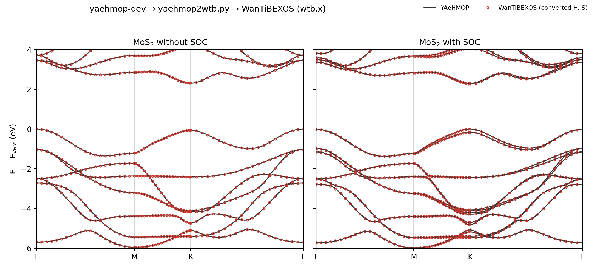

# interface: YAeHMOP H and S → WanTiBEXOS, and DFT structures → YAeHMOP

**Structure converter.** `kel_crystal_conversion.py` writes a periodic YAeHMOP input from the crystal
structure of another code (one file, Python standard library only):

```bash
python3 kel_crystal_conversion.py --format VASP   --in POSCAR             # -> POSCAR.bind
python3 kel_crystal_conversion.py --format AIMS   --in geometry.in --out MoS2.bind
python3 kel_crystal_conversion.py --format SIESTA --in MoS2.fdf            # also .XV, .STRUCT_OUT
python3 kel_crystal_conversion.py --format DFTB   --in geo_end.gen         # or dftb_in.hsd
python3 kel_crystal_conversion.py --format QE     --in scf.in --band "G 0 0 0, M 0.5 0 0, K 1/3 1/3 0, G 0 0 0" \
        --band-points 40 --kmesh 11 11 1 --average-properties --const 1.75
python3 kel_crystal_conversion.py --help                                   # every option
```

The periodic dimension comes from the vacuum (an empty slab of 6 Å or more across a lattice direction;
`--dimension` forces it); non-periodic directions are moved to the end, and atoms wrapped across the
vacuum are brought back next to their slab, since YAeHMOP has no images along those directions.
Checked on a 4L TiTe2 slab (with one Te wrapped across the vacuum), anatase TiO2 and rutile TiS2: the
YAeHMOP bands of the inputs converted from VASP (direct and Cartesian), FHI-aims (atom and atom_frac),
DFTB+ (.gen, inline hsd), QE (crystal and angstrom) and SIESTA (.fdf Ang and Fractional, .XV,
.STRUCT_OUT) agree with each other to the 1e-5 eV printed in the .band file.

---

# YAeHMOP H and S → WanTiBEXOS

Two converters read the Hamiltonian and overlap written by YAeHMOP (this fork, `yaehmop-dev`)
and write them in the non-orthogonal tight-binding format of
[WanTiBEXOS](https://github.com/ac-dias/wantibexos), the same layout as `siesta2wtb.py`,
read with `DFT= S`:

| script | what it writes |
|--------|----------------|
| `yaehmop2wtb.py` (lean) | only the results of the run: `huckel-<TYPE>.dat` (H and S), `basis_set-<TYPE>` and, with `--rmatrix`, `huckel-<TYPE>_r.dat` (position matrix). Energy zero: the midgap of the mesh if there is a gap, otherwise the Fermi level of the `.out`, or `--efermi`. Needs numpy. |
| `yaehmop2wtb-full.py` | the same files, plus the choice of energy zero (`--zero auto\|fermi\|midgap\|<eV>`), `input-<TYPE>.dat` and `kpoints.dat` (the band path of `RUN.bind`) ready for `wtb.x < input-<TYPE>.dat`, a log `yaehmop2wtb-<TYPE>.log`, and `--allow-aliasing`. Needs numpy and scipy; `--rmatrix` imports `yaehmop2wtb.py`, so keep both scripts in the same folder. |

With their default energy zero both write identical TB, basis and position-matrix files
(checked on the MoS2 example with and without SOC and on spin-polarized bcc Fe).
A step-by-step tutorial for MoS2 with SOC is in [`yaehmop2wtb_recipe/`](yaehmop2wtb_recipe/).
Both handle the kinds of run of the fork:

| YAeHMOP run | outputs used | WanTiBEXOS files |
|-------------|--------------|------------------|
| spinless (`bind RUN.bind params.dat`) | `RUN.bind.HAM`, `.OV`, `.out` | `huckel-NP.dat`, `basis_set-NP` |
| SOC (`bind --soc soc.dat RUN.bind params.dat`) | same, with 2n×2n spinor matrices | `huckel-SOC.dat`, `basis_set-SOC` |
| spin polarized (`bind --parm-up ... --parm-down ... RUN.bind`) | `RUN_up.bind.*`, `RUN_down.bind.*` | `huckel-SP.dat`, `basis_set-SP` |

## 1. Prepare the YAeHMOP run

The input must contain `Dump Hamil`, `Dump Overlap` and a `K points` block with a
**full Γ-centred mesh** `N1×N2×N3`. YAeHMOP writes H(k) and S(k) at those points, and the
script turns them into H(R), S(R) by an inverse Fourier transform.

The k points of the input are in **reduced coordinates**, i.e. fractions of the reciprocal
lattice vectors b_i (a_i·b_j = 2π δ_ij): the point (k₁, k₂, k₃) is the wave vector
K = k₁b₁ + k₂b₂ + k₃b₃ (for example K = (1/3, 1/3, 0)). The cells are labelled by integer
indices (R₁, R₂, R₃), the cell at T_R = R₁a₁ + R₂a₂ + R₃a₃. On the mesh,
k_i ∈ {0, 1/N_i, …, (N_i−1)/N_i}, and

    H(R) = (1/N) Σ_{k₁,k₂,k₃} exp[−2πi (k₁R₁ + k₂R₂ + k₃R₃)] H(k),    |R_i| ≤ r_i

The 2π is there because k_i are reduced coordinates and R_i integers:
K·T_R = 2π (k₁R₁ + k₂R₂ + k₃R₃), so this is the usual exp(−i K·T_R) of Cartesian vectors.
It is also YAeHMOP's own phase: its Bloch sums in `K_overlap_mat.c` use
`kdotR = TWOPI*(k₁R₁ + k₂R₂ + k₃R₃)` with the k_i read from the input.

YAeHMOP sums the lattice up to `r` cells in each direction (second line of the `Lattice`
section, e.g. `5 5 0`). The transform is therefore **exact** when

- `N_i ≥ 2 r_i + 1` along each periodic direction (11×11×1 for `5 5 0`, 11×11×11 for
  `5 5 5`). With a smaller mesh the script stops; `--allow-aliasing` forces an
  approximate conversion.
- the k points are written with **12 or more decimals** (e.g. `0.090909090909091`).
  YAeHMOP uses them exactly as written, and with 6-8 decimals the rebuilt H(k) is only good
  to ~10⁻⁵-10⁻⁶ eV. The script warns when the points are rounded.

A mesh block can be generated with a few lines of Python:

```python
N = 11
pts = [(i/N, j/N, 0.0) for i in range(N) for j in range(N)]       # 2D; add k/N for 3D
print("K points"); print(len(pts))
for a, b, c in pts: print(f"{a:.15f} {b:.15f} {c:.15f} 1.0")
```

Add a `Band` block too, if you want `yaehmop2wtb-full.py` to write the k path for WanTiBEXOS.

## 2. Convert

```
python3 yaehmop2wtb.py      path/to/RUN.bind -o wtb_folder [--efermi <eV>] [--rmatrix [--params PARMS [PARMS_DOWN]]]
python3 yaehmop2wtb-full.py path/to/RUN.bind -o wtb_folder [--zero auto|fermi|midgap|<eV>] [--rmatrix ...]
```

`RUN.bind` is the input file of the run, with the outputs next to it. The kind of run is
detected from the files: `.SOC` states in the `.out` mean SOC, and `RUN_up`/`RUN_down` files
mean spin polarized. The orbitals of each element come from the `.out` (Extended Hückel
Parameters; double-zeta p shells, listed as `3P DZ:`, included). The structure, the lattice and the k points come from `RUN.bind`
(crystallographic or Cartesian geometry; `*` atoms with parameters given in the input are
not supported).

The script checks itself: it rebuilds H(k) and S(k) on the mesh from H(R), S(R) (error
~10⁻¹² eV when the conditions above hold). It also checks that H(R) is real (spinless and
spin polarized) and that S(R) is real. The lean script prints these numbers; the full one
also writes them to its log.

**Energy zero.** `wtb.x` diagonalizes (H(k) − E_F·I, S(k)), which is not a rigid shift
when S ≠ I. The file therefore holds H(R) − E0·S(R) with Fermi level 0, so `wtb.x` gives
exactly the YAeHMOP eigenvalues minus E0. In a semiconductor YAeHMOP puts the Fermi level
at the VBM, where `wtb.x` would count the occupied bands wrongly (gap ≈ 0), so by default
both scripts use the midgap. `yaehmop2wtb.py` takes the default or `--efermi`;
`yaehmop2wtb-full.py` has these choices:

- `auto` (default): the midgap of the mesh eigenvalues if there is a gap, otherwise the
  Fermi level of the `.out` (`Average Properties` needed). If S(k) is not positive definite
  on the mesh (truncated lattice sums), the midgap cannot be computed and the Fermi level is used;
- `fermi`, `midgap`, or a value in eV.

In a spin-polarized run each channel uses its own zero, so that both channels have E_F at
0, as when they were fitted to a DFT calculation.

**File layout** (as `siesta2wtb.py`): `NP`/`SOC`/`SP`, scissors (0), Fermi level (0),
three lattice vectors [Å], basis size, number of R vectors, a comment line, then one line
`Rx Ry Rz [Å]  i  j  ReH  ImH  S` per element. The basis file has
`index species x y z l m spin`. With SOC and SP the orbitals 1..n are spin up (spin 1)
and n+1..2n spin down (spin −1). In SP the up-down blocks are zero.

**Position matrix (`--rmatrix`).** As `siesta2wtb.py --rmatrix`, both scripts can write
`huckel-<TYPE>_r.dat`, the matrix X_ij(R) = ⟨φ_i,0| **r** |φ_j,R⟩ of the basis in Å
(absolute coordinates, the frame of `basis_set-*`), in the layout of Wannier90's
`seedname_r.dat`: integer R, then `m n Re(x) Im(x) Re(y) Im(y) Re(z) Im(z)`, with m running
fastest. WanTiBEXOS reads it as `BSE_CENTER_FILE` with `DFT= S`, for the dipoles between basis
orbitals that H(R), S(R) and the orbital centres miss. The R vectors are those of the TB file;
**r** is spin diagonal (the up-down blocks are zero).

- The orbitals are the normalized Slater functions of YAeHMOP, c₁ r^(n−1) e^(−ζ₁r)
  [+ c₂ r^(n−1) e^(−ζ₂r)] times real spherical harmonics, with the bohr of YAeHMOP's overlaps
  (1/1.889644746 Å). The integrals are numerical: bipolar coordinates for two centres,
  spherical for one, for the atom pairs with a non-zero overlap in YAeHMOP.
- The same quadrature gives S, and the script prints the largest difference from YAeHMOP's
  S. That difference checks the orbitals and the quadrature.
- The `.out` prints the exponents with only 4 decimals, so S then agrees to ~5×10⁻⁵.
  `--params` gives the parameter file of the run, for the full precision: S then agrees to
  ~5×10⁻⁷, the 6 decimals of the parameter file. The parameter file does not apply after
  charge iteration or zeta variation, where the `.out` has the final exponents.
- SP: the two channels have their own orbitals, so X is computed per channel (`--params UP
  DOWN`). The same holds for SOC on two tables with different zetas; there `--params UP
  DOWN` is required, because the `.out` does not list the down functions in full.
- Cost: ~35 s for the MoS2 example and ~10 s for bcc Fe with overlap radius 2.

Checks on the MoS2 example with `--params`: S agrees to 2.9×10⁻⁷. The diagonal X_ii(0) gives
the atomic positions to 3×10⁻⁷ Å. X_ij(R) = X_ji(−R) + T_R S_ji(−R), with T_R the lattice
vector of R, holds to 4×10⁻⁶ Å. The on-site dipole ⟨Mo 5s| z |Mo 5p_z⟩ is 0.915 Å.

### How the position matrix is computed

The code is in `yaehmop2wtb.py` (`Atom`, `_quadrature`, `_gauss`, `position_matrix`,
`rmatrix_file`); `yaehmop2wtb-full.py --rmatrix` calls the same functions.

**1. The basis functions.** Each orbital is the function YAeHMOP uses for its overlaps,

    φ(r) = R_nl(r) · Y_lm(r̂),      R_nl(r) = Σ_k c_k N_k r^(n−1) e^(−ζ_k r),
    N_k = (2ζ_k)^(n+1/2) / √((2n)!)

with one Slater function (s, single-ζ p) or two (double-ζ p, d, f). The coefficients are
taken as `bind` uses them:

- s and single-ζ p: c = 1;
- double-ζ shells: c₁ and c₂ normalized with the overlap of the two exponents,
  S₁₂ = [4ζ₁ζ₂/(ζ₁+ζ₂)²]^(n+1/2), so that c₁² + c₂² + 2c₁c₂S₁₂ = 1;
- single-ζ d and f: c₁ as given.

The `.out` prints the coefficients already normalized. With `--params`, the script reads the
raw ones from the parameter file and normalizes them the same way.

The exponents are in bohr⁻¹. They are converted with the bohr of YAeHMOP's overlap routine,
`AUI` = 1.889644746 bohr/Å in `R_overlap_mat.c` (1 bohr = 0.529200 Å), and **not** with the
`BOHR` = 0.52918 of `bind.h`. With the wrong constant, S is off by ~3×10⁻⁵.

Y_lm are the real spherical harmonics, with YAeHMOP's orbital order and sign convention:

| shell | orbitals (order of the H/S dumps) | angular part × √(4π) |
|---|---|---|
| s | s | 1 |
| p | p_x, p_y, p_z | √3 · (x, y, z)/r |
| d | d_x²−y², d_z², d_xy, d_xz, d_yz | √15/2 (x²−y²), √5/2 (3z²−r²), √15 xy, √15 xz, √15 yz (over r²) |
| f | f_z³, f_xz², f_yz², f_xyz, f_z(x²−y²), f_x(x²−3y²), f_y(3x²−y²) | the standard real l = 3 harmonics |

The comparison with YAeHMOP's S in step 4 would expose any sign or order mistake.

**2. The integrals.** For each lattice vector R of the TB file and each pair of atoms A (home
cell) and B (cell R), all orbital pairs of the two atoms are integrated at once:

    S_ij(R) = ∫ φ_i(r − A) φ_j(r − B − T_R) d³r
    X_ij(R) = ∫ φ_i(r − A) r φ_j(r − B − T_R) d³r      (r absolute, in Å)

T_R is the Cartesian lattice vector of R. Pairs are skipped when YAeHMOP's S block for them
is zero, for example beyond its `Rho` distance cutoff. Pairs are also skipped when the atoms
are farther apart than the sum of their orbital radii R_c. R_c of an atom is the largest r
where |R_nl(r)|·r is still above 10⁻⁷ for any of its shells: ~10 Å for Mo and ~8 Å for S.

**3. The quadrature.** The Slater functions have no cutoff, are smooth except at the nuclei,
and decay exponentially. The coordinates are chosen so that the integrands are smooth on
each integration piece:

- **Two centres** (d = |B − A| > 0): bipolar coordinates (r_a, r_b, ϕ) about the A–B axis,
  with volume element r_a r_b / d · dr_a dr_b dϕ:
  - r_a runs over [0, R_c(A)];
  - for each r_a, r_b runs over [|r_a − d|, min(r_a + d, R_c(B))];
  - ϕ uses 12 equally spaced points.
- **One centre** (same atom, R = 0, which gives the on-site dipoles ⟨s|r|p⟩, ⟨p|r|d⟩, …):
  spherical coordinates about A, with r over [0, R_c], 10 Gauss-Legendre points in cos θ and
  12 points in ϕ.
- **Angular rules:** after multiplying by r, the integrand is a trigonometric polynomial of
  degree ≤ l_i + l_j + 1 (≤ 7 up to f–f). The ϕ rule and the cos θ rule integrate that
  exactly, so the only approximation is radial.
- **Radial rules:** Gauss-Legendre with 10 points per piece:
  - pieces of at most 2 Å;
  - graded near the nuclei (edges at 0.05, 0.1, 0.2, … Å), for the compact components of d
    and f shells (e.g. ζ = 6.09 bohr⁻¹ in Fe 3d);
  - split where the integrand has kinks: in r_a at r_a = d and r_a = R_c(B) − d, where the
    limits of the r_b range change form. With 1 Å pieces in bcc Fe, these cuts bring the
    error from ~5×10⁻⁵ to 3×10⁻⁹.

**4. The check.** The same points and weights give S_ij(R). The script prints the largest
|S(quadrature) − S(YAeHMOP)| over all R, against the S(R) it has just written to the TB file.
That one number tests the orbitals (exponents, coefficients, harmonics, unit) and the
quadrature together:

| case | exponents from | max \|ΔS\| |
|---|---|---|
| MoS2 (NP and SOC) | `.out` (4 decimals) | 5×10⁻⁵ |
| MoS2 (NP and SOC) | `--params` (6 decimals) | 2.9×10⁻⁷ |
| bcc Fe SP, both channels | `--params` up + down | 5.7×10⁻⁷ |

The two limits are different. In MoS2 the 2.9×10⁻⁷ does not change with a finer quadrature:
it is the 6-decimal precision of the exponents in the parameter file. In bcc Fe it is the
default quadrature (2 Å pieces, 10 points): with 1 Å pieces it drops to 3×10⁻⁹, at about twice
the cost.

**5. Spin and the output.**
- **r** is spin diagonal, so for NP the file has one block, and for SOC and SP the up–up and
  down–down blocks are filled and the up–down blocks are zero.
- SOC with one parameter table: the two diagonal blocks are the same X.
- SP, and SOC on two tables with different zetas: each channel has its own orbitals. X is
  computed per channel with its own exponents and checked against its own S block
  (S = diag(S_up, S_down)).
- The file follows `seedname_r.dat`, as `siesta2wtb.py --rmatrix` writes it:
  - a comment line, the basis size, the number of R vectors;
  - per R, one line `R1 R2 R3  m  n  Re X_x  Im X_x  Re X_y  Im X_y  Re X_z  Im X_z` per
    pair (m, n), with m running fastest. The imaginary parts are zero, because the orbitals
    are real.

The matrix is in absolute coordinates, so it is not Hermitian by itself. It satisfies
X_ij(R) = X_ji(−R) + T_R S_ji(−R); on the MoS2 example this holds to 4×10⁻⁶ Å.

## 3. Run WanTiBEXOS

```
module load wtb-teste
cd wtb_folder && mkdir -p out
wtb.x < input-SOC.dat          # bands in out/bands.dat (energies relative to the VBM)
```

## Example: MoS2 monolayer (`example_MoS2/`)

The parametrization is the yaehmop-bandfit fit to FHI-aims HSE06+SOC bands (the same one as
`new_tests/MoS2_SOC`). The input `MoS2.bind` has the band path Γ-M-K-Γ (40 points per line)
and the 11×11×1 mesh with 15 decimals. `run_example.sh` does everything:

```
cd example_MoS2
./run_example.sh      # yaehmop-dev (with and without SOC) -> yaehmop2wtb-full.py -> wtb.x -> compare_bands.py
```

| folder / file | content |
|---------------|---------|
| `MoS2.bind`, `MoS2_params.dat`, `MoS2_soc.dat` | YAeHMOP input, EHT parameters, SOC constants |
| `yaehmop_soc/`, `yaehmop_nosoc/` | YAeHMOP outputs (`.band`, `.HAM`, `.OV`, `.out`, `.SOC`) |
| `wtb_soc/`, `wtb_nosoc/` | converted files (`huckel-*.dat`, `basis_set-*`), `input-*.dat`, `kpoints.dat`, conversion log, `wtb.x` outputs in `out/` |
| `compare_bands.py` | comparison YAeHMOP × WanTiBEXOS, point by point on the same k points |
| `validation.txt`, `bands_yaehmop_vs_wtb.png` | results |

Results (energies relative to the VBM, bands within VBM−6 … VBM+4 eV):

| | without SOC | with SOC |
|---|---|---|
| converted file diagonalized in double precision vs YAeHMOP | 5.4×10⁻⁷ eV | 5.4×10⁻⁷ eV |
| WanTiBEXOS (`wtb.x`) vs YAeHMOP | 4.9×10⁻⁵ eV | 6.6×10⁻⁵ eV |
| band gap, YAeHMOP / WanTiBEXOS | 2.312981 / 2.312991 eV | 2.268108 / 2.268106 eV |
| SOC splitting at K, YAeHMOP / WanTiBEXOS | — | 0.165011 / 0.165014 eV |



The remaining differences come from `wtb.x`, which works in single precision. The converted
file itself reproduces YAeHMOP to 5×10⁻⁷ eV; this is the 8-digit precision of the YAeHMOP
`.band` file. Over all bands the differences reach 10⁻³ eV for `wtb.x`, in states 100 eV or
more above the gap.

**Spin-polarized check (bcc Fe, not included as files).** The Fe fit of `new_tests/Fe_spin`
was run on an 11×11×11 mesh and converted to `huckel-SP.dat`. The rebuilt H(k) error was
10⁻¹² eV. `wtb.x` read the SP file and gave the bands of both channels: the double-precision
bands of the file agree with YAeHMOP to 5×10⁻⁷ eV and the `wtb.x` bands to 10⁻³ eV in the window
E_F−8 … E_F+6 eV. The larger `wtb.x` error than in MoS2 comes from single precision with the
nearly singular S(k) of Fe. Far above E_F (4p states at ~5700 eV) single precision fails
completely, which does not affect the bands near E_F.

## Runs with the newer options of yaehmop-dev

- `bind --soc soc.dat --parm-up up.dat --parm-down down.dat RUN.bind` (SOC on top of two
  spin channels) writes one 2n x 2n spinor dump and is converted as a SOC run
  (`huckel-SOC.dat`). With different zetas S = diag(S_up, S_down), and `--rmatrix` needs
  `--params up.dat down.dat`.
- `bind --common-fermi --parm-up ... --parm-down ... RUN.bind`: both scripts read the common
  Fermi level from `RUN.bind.spin` and uses it as the energy zero of both channels, so the
  spin-up and spin-down bands keep their relative position. Without `--common-fermi`
  (fixed moment) each channel keeps its own Fermi level as zero, as before.
