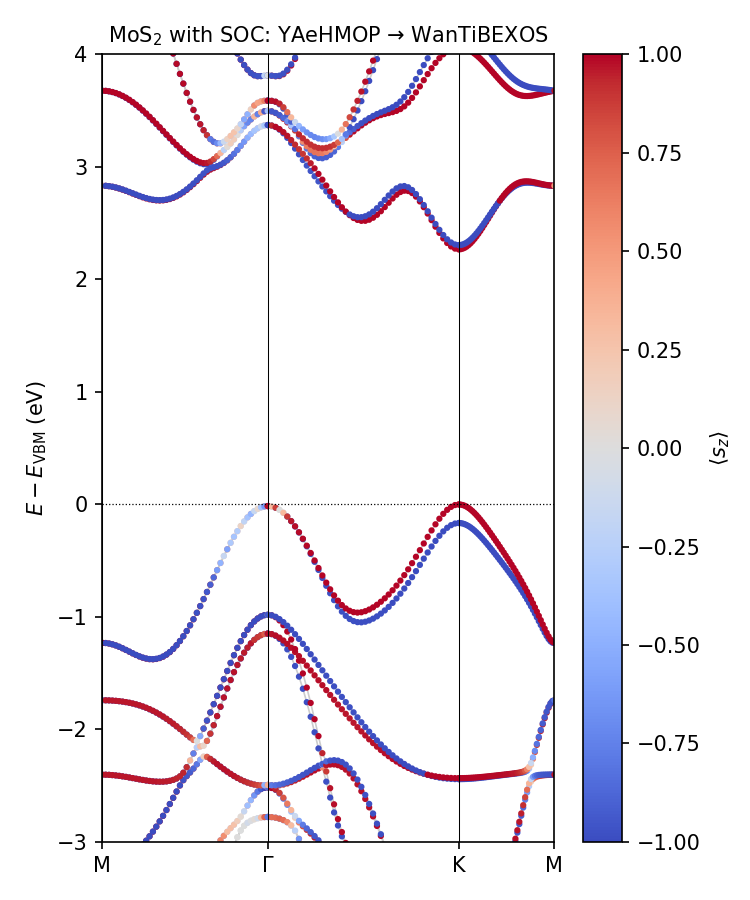

# Recipe: YAeHMOP → WanTiBEXOS (MoS₂ monolayer with spin-orbit coupling)

This recipe is the YAeHMOP counterpart of the
[`siesta2wtb` recipe](https://github.com/ac-dias/wantibexos-recipes/tree/master/siesta2wtb) of
WanTiBEXOS. It covers three steps:

1. computing an extended Hückel tight-binding model of a MoS₂ monolayer with spin-orbit
   coupling (SOC) in YAeHMOP;
2. converting it with `yaehmop2wtb.py` into the files WanTiBEXOS reads: the model (H and S),
   the basis and the position matrix, written to `out-interface/`;
3. computing the band structure with WanTiBEXOS (`wtb.x`).

The whole recipe runs in under a minute, most of it for the position matrix. Each step is explained below, so that you can adapt
it to your own system.



*MoS₂ with SOC computed by WanTiBEXOS from the converted YAeHMOP model, colored by the spin
⟨s_z⟩ of each state. The gap at K is 2.268 eV, and the top valence band at K is split by
165 meV.*

---

## Contents

| file | what it is |
|------|------------|
| `yaehmop/MoS2.bind` | YAeHMOP input: structure, k points, what to compute |
| `yaehmop/MoS2_params.dat` | extended Hückel parameters (H_ii, Slater exponents) of Mo and S |
| `yaehmop/MoS2_soc.dat` | spin-orbit constants λ of Mo d and S p |
| `out-interface/` | where the converter writes its outputs (empty in git; its `.gitignore` keeps them out) |
| `wtb/input.dat` | WanTiBEXOS input |
| `wtb/kpoints.dat` | k path for the WanTiBEXOS bands (M–Γ–K–M) |
| `wtb/plot_bands.py` | plots the WanTiBEXOS bands (`bands.png`) |
| `run_recipe.sh` | runs all the steps below in one go |
| `bands_reference.png` | the figure above, to compare with your run |

The converter itself is one folder up: `../yaehmop2wtb.py`.

## Requirements

- **YAeHMOP** from this fork (`yaehmop-dev`): the executable is called `yaehmop`.
  Do not type `bind`, which is a bash built-in command.
- **WanTiBEXOS** (`wtb.x`).
- **Python 3 with numpy** for the converter, and matplotlib for the figure.

On our machines everything is loaded with `module load yaehmop-dev wtb-teste`.

## Quick run

```bash
cd interface/yaehmop2wtb_recipe
./run_recipe.sh
```

Open `run_recipe.sh` first if your machine has no `module` command: it only needs `yaehmop`
and `wtb.x` in the `PATH`. The script runs the commands of steps 2 to 5 below.

---

## Step by step

### Background: why H and S?

YAeHMOP describes the electrons with **atomic orbitals** (Slater functions centred on the
atoms). These orbitals are **not orthogonal**: the overlap between neighbouring orbitals,
S_ij = ⟨φ_i|φ_j⟩, is not zero. The bands therefore come from the generalized eigenvalue
problem

    H(k) c = E S(k) c

so a model needs both matrices, the Hamiltonian H and the overlap S. WanTiBEXOS reads
this kind of model with `DFT= S`, the same mode it uses for SIESTA.

WanTiBEXOS wants the matrices in **real space**, H(R) and S(R), where R labels the unit cell
an orbital sits in. YAeHMOP writes them in **reciprocal space**, H(k) and S(k), on a list of k
points. `yaehmop2wtb.py` turns one into the other.

### Step 1: the YAeHMOP input (`yaehmop/MoS2.bind`)

Open `yaehmop/MoS2.bind`. Most of it is a normal YAeHMOP band-structure input; the parts in
**bold** in the table are what the conversion needs.

| block | in this recipe | why |
|-------|----------------|-----|
| `Geometry Crystallographic` | Mo and two S in fractional coordinates, plus two dummy Mo atoms | the dummy atoms 4 and 5 only mark the ends of the lattice vectors **a** and **b** |
| `Lattice` | `2` (periodic in 2D), then `5 5 0`, then `1 4` and `1 5` | **`5 5 0` is the overlap radius r**: YAeHMOP sums the interactions up to 5 cells away along **a** and **b** |
| `Crystal Spec` | a = b = 3.163 Å, c = 16 Å, γ = 120° | unit cell of the crystallographic coordinates |
| `THE CONST` | 1.722 | the K constant of the Wolfsberg–Helmholz formula (part of the fit) |
| `Band` | 40 points per line along Γ–M–K–Γ | the bands YAeHMOP itself prints, in `MoS2.bind.band` |
| `Average Properties`, `Electrons 18` | | **the Fermi level and the electron count**, used by the converter to place the energy zero |
| **`Dump Hamil`, `Dump Overlap`** | | **make YAeHMOP write H(k) and S(k)** to the binary files `MoS2.bind.HAM` and `MoS2.bind.OV` |
| **`K points`** | 121 points: the full 11×11×1 mesh | **the k points where H(k) and S(k) are written** |

The `K points` block has to follow three rules:

1. **Full Γ-centred mesh.** List every point k = (i/N₁, j/N₂, 0), with i = 0…N₁−1 and
   j = 0…N₂−1. Do not reduce it by symmetry, and give every point weight 1.0.
2. **N_i ≥ 2 r_i + 1.** With the overlap radius r = 5 the mesh needs at least 11 points along
   each periodic direction, hence 11×11×1. With fewer points the conversion is not exact,
   and the script stops.
3. **12 or more decimals.** YAeHMOP uses the numbers exactly as written: 1/11 must be
   `0.090909090909091`, not `0.0909`. With 6–8 decimals the conversion is only good to
   ~10⁻⁵ eV, and the script prints a warning.

The k points are in **reduced coordinates**, i.e. fractions of the reciprocal lattice
vectors. For example, (1/3, 1/3, 0) is the K point. A mesh block for another N can be
printed with:

```python
N = 11
pts = [(i/N, j/N, 0.0) for i in range(N) for j in range(N)]   # 2D; for 3D add k/N
print("K points"); print(len(pts))
for a, b, c in pts: print(f"{a:.15f} {b:.15f} {c:.15f} 1.0")
```

The two parameter files are plain text:

- `MoS2_params.dat`: one line per shell, with the columns
  `element Z valence-electrons number-of-zetas n l H_ii ζ₁ ζ₂ c₁ c₂`. For example, Mo 4d has
  two Slater functions (ζ₁ = 4.869, ζ₂ = 1.644 bohr⁻¹).
- `MoS2_soc.dat`: one line per shell with SOC, `element shell λ(eV)`
  (Mo d: 0.063 eV, S p: 0.198 eV).

This parametrization was fitted to HSE06+SOC bands of FHI-aims with yaehmop-bandfit.

### Step 2: run YAeHMOP

```bash
cd yaehmop
yaehmop --soc MoS2_soc.dat MoS2.bind MoS2_params.dat > yaehmop.log
```

`--soc MoS2_soc.dat` switches on spin-orbit coupling: every orbital comes in a spin-up
and a spin-down copy, so the 17 orbitals of MoS₂ (Mo: 5s, 5p, 4d; S: 3s, 3p) become 34
spin-orbitals. The run takes less than a second and writes these files next to the input:

| file | content |
|------|---------|
| `MoS2.bind.out` | text output: parameters, Fermi level (`#Fermi_Energy`), SOC information |
| `MoS2.bind.HAM`, `MoS2.bind.OV` | **H(k) and S(k) on the 121 mesh points** (binary; 34×34 complex matrices) |
| `MoS2.bind.band` | YAeHMOP's own bands along Γ–M–K–Γ |
| `MoS2.bind.SOC`, `MoS2.bind.status` | SOC details, run status |

### Step 3: convert to the WanTiBEXOS format

Still in `yaehmop/`:

```bash
python3 ../../yaehmop2wtb.py MoS2.bind -o ../out-interface --rmatrix --params MoS2_params.dat
```

- `MoS2.bind` is the YAeHMOP input. You only give this file; the script finds the outputs
  of step 2 next to it.
- `-o ../out-interface` writes the converted files into the folder `out-interface/` of
  this recipe, where you can look at them. Its `.gitignore` keeps them out of git.
- `--rmatrix` also writes the position matrix, which WanTiBEXOS uses for excitons and
  optical spectra. It is explained at the end of this step and takes ~35 s; without it the
  conversion takes about a second.
- `--params MoS2_params.dat` gives the parameter file of the run, used by `--rmatrix`.

The script prints:

```
MoS2.bind: SOC, 17 orbitals x 2 spins, mesh 11x11x1, overlap radius [5, 5, 0]
  E0 = -7.827960 eV, midgap of the mesh (VBM -9.025113, CBM -6.630808 eV); file holds H - E0 S; 97 R vectors; H(k), S(k) rebuilt to 2.8e-13 eV, 2.5e-14
written: ../out-interface/huckel-SOC.dat, ../out-interface/basis_set-SOC
written: ../out-interface/huckel-SOC_r.dat (BSE_CENTER_FILE); exponents from MoS2_params.dat; max |S(quadrature) - S(YAeHMOP)| = 2.9e-07
```

Line by line:

- **`SOC, 17 orbitals x 2 spins`:** the kind of run, detected from the files. A run without
  `--soc` gives `NP`, and a spin-polarized run gives `SP`; see "Other kinds of run" below.
- **`mesh 11x11x1, overlap radius [5, 5, 0]`:** the script checked that the mesh is large
  enough for the overlap radius.
- **`E0 = -7.827960 eV, midgap`:** the energy zero. YAeHMOP puts the Fermi level of a
  semiconductor at the top of the valence band (−9.025 eV), but WanTiBEXOS needs it *inside*
  the gap to count the occupied bands. The script therefore uses the middle of the gap,
  and the file holds H − E0·S, with Fermi level 0. A plain shift H − E0 would not work,
  because S ≠ 1. To choose another zero, use `--efermi <eV>`.
- **`97 R vectors`:** the cells kept in the real-space model (the 11×11 = 121 cells within
  the overlap radius, minus those whose H and S are all below 10⁻¹⁰).
- **`H(k), S(k) rebuilt to 2.8e-13 eV`:** the self-check. From H(R), S(R) the script
  rebuilds H(k), S(k) on the mesh and compares them with YAeHMOP's. An error of ~10⁻¹³ means
  the conversion is exact.
- **`max |S(quadrature) - S(YAeHMOP)| = 2.9e-07`:** the self-check of the position matrix
  (see below).

What the conversion does:

    H(R) = (1/N) Σ_k exp[−2πi (k₁R₁ + k₂R₂ + k₃R₃)] H(k)      (same for S)

Here k_i are the reduced coordinates of the mesh, R_i the integer cell indices, and N = 121.
The transform is exact because YAeHMOP's own lattice sums stop at 5 cells, and an 11-point
mesh resolves exactly that many.

Now look at the three files in `out-interface/`:

**`huckel-SOC.dat`, the tight-binding model (H and S).** The header has `SOC`, the scissors
operator (0), the Fermi level (0), the three lattice vectors (Å), the basis size (34) and the
number of R vectors (97). Then there is one line per matrix element,

    Rx  Ry  Rz   i   j   Re H_ij   Im H_ij   S_ij

with (Rx, Ry, Rz) the Cartesian position of cell R in Å. This is the same layout as the
`tb-*.dat` of `siesta2wtb.py`.

**`basis_set-SOC`, the basis the model is written in.** One line per spin-orbital,
`index species x y z l m spin`. For example, the first line

    1   Mo   -0.00028414   1.82586726   8.00013920   0   0   1

is the Mo s orbital (l = 0, m = 0), spin up, at the Mo position in Å. Orbitals 1–17 are spin
up (spin 1) and 18–34 are spin down (spin −1). The order in each block is Mo s, p_x, p_y, p_z,
d_x²−y², d_z², d_xy, d_xz, d_yz, then S s, p_x, p_y, p_z for each S.

**`huckel-SOC_r.dat`, the position matrix.** For excitons and optical spectra (BSE),
WanTiBEXOS also needs the matrix elements of the position operator between basis orbitals,

    X_ij(R) = ⟨φ_i, cell 0 | r | φ_j, cell R⟩      (in Å, absolute coordinates)

`siesta2wtb.py --rmatrix` writes this file for SIESTA. The layout is that of Wannier90's
`seedname_r.dat`:
- three header lines: a comment, the basis size (34) and the number of R vectors (97);
- then one line per element: `R1 R2 R3  i  j  Re X  Im X  Re Y  Im Y  Re Z  Im Z`, with integer
  R and i running fastest.

Two lines of the home cell (R = 0 0 0) show what the numbers mean:

    0    0    0    1    1   -0.0002841388  0.0000000000   1.8258672594  0.0000000000   8.0001392000  0.0000000000
    0    0    0    1    4   -0.0000000000  0.0000000000   0.0000000000  0.0000000000   0.9148321966  0.0000000000

- **⟨Mo s| r |Mo s⟩** (orbitals 1 and 1) is the Mo position, the same numbers as in
  `basis_set-SOC`.
- **⟨Mo s| r |Mo p_z⟩** (orbitals 1 and 4) is an on-site dipole: 0.915 Å along z. These
  orbital-to-orbital dipoles are what H, S and the orbital positions alone cannot give.

YAeHMOP has no position integrals, so the script computes them numerically from the Slater
orbitals of the run. That is why it needs `--params`: the parameter file has the exponents
with 6 decimals, while the `.out` prints only 4. As a check, it recomputes the overlap S
with the same integration and compares it with YAeHMOP's: 2.9×10⁻⁷ here. `../README.md`
explains how the matrix is computed.

To use it in a BSE run, copy it next to the input and add
`BSE_CENTER_FILE= "huckel-SOC_r.dat"` to `input.dat`. The band structure of this recipe
does not need it.

`../../yaehmop2wtb.py --help` lists all the options.

### Step 4: run WanTiBEXOS

```bash
cp ../out-interface/huckel-SOC.dat ../wtb/
cd ../wtb
mkdir -p out
wtb.x < input.dat > wtb.log
```

You may need `ulimit -s unlimited` and `export OMP_NUM_THREADS=1 KMP_STACKSIZE=500mb`
first, as in `run_recipe.sh`. The input `wtb/input.dat`:

```
NTHREADS= 4                    ! OpenMP threads
SYSDIM= "2D"                   ! a monolayer
DFT= S                         ! non-orthogonal model: H and S (the format of siesta2wtb.py and yaehmop2wtb.py)

PARAMS_FILE= "huckel-SOC.dat"  ! the file written in step 3
KPATH_FILE= "kpoints.dat"      ! the k path for the bands
OUTPUT= "./out/"
CALC_DATA= "./out/"

BANDS= T                       ! compute the band structure
```

(The `!` comments are only for this README; the real file has none.)

The k path `wtb/kpoints.dat`:

```
6                              ! number of lines below with a k point (3 segments x 2 ends)
50                             ! points per segment
0.50000000 0.00000000 0.00000000 M
0.00000000 0.00000000 0.00000000 G     ! segment 1: M -> Gamma
                                       ! (a blank line between segments)
0.00000000 0.00000000 0.00000000 G
0.33333333 0.33333333 0.00000000 K     ! segment 2: Gamma -> K
...
```

The points are again in reduced coordinates. `wtb.x` takes less than a second and writes
these files in `out/`:

| file | content |
|------|---------|
| `bands.dat` | the bands: one block per band, columns k-path, E − E_VBM (eV), ⟨s_x⟩, ⟨s_y⟩, ⟨s_z⟩, orbital weight |
| `gap-kpath.dat` | fundamental and direct gaps along the path |
| `cbm_vbm-kpath.dat` | where the band edges are |
| `KLABELS.dat` | positions of the high-symmetry points on the path |
| `log.dat` | the input as WanTiBEXOS read it |

### Step 5: check the result

```bash
cat out/gap-kpath.dat          # fundamental band gap (eV): 2.268106
python3 plot_bands.py          # -> bands.png, compare with ../bands_reference.png
```

Expected numbers:

| quantity | WanTiBEXOS (this recipe) | YAeHMOP |
|----------|--------------------------|---------|
| band gap (direct, at K) | 2.268106 eV | 2.268108 eV |
| SOC splitting of the top valence band at K | 165.0 meV | 165.0 meV |

The two programs agree to ~10⁻⁵ eV. The small difference comes from `wtb.x`, which works
in single precision; the converted file itself reproduces YAeHMOP to 10⁻⁷ eV. In the
figure, the two valence bands at K have opposite spin (red ⟨s_z⟩ = +1, blue −1), the
spin-valley locking of MoS₂.

---

## Adapting the recipe to your system

1. **Write the YAeHMOP input** for your structure. `../kel_crystal_conversion.py` can
   generate it from VASP, FHI-aims, SIESTA, DFTB+ or Quantum ESPRESSO files (see
   `../README.md`).
2. **Add** `Dump Hamil`, `Dump Overlap`, `Average Properties`, the electron count, and a
   full Γ-centred `K points` mesh with N_i ≥ 2r_i + 1 and 15 decimals (the Python lines in
   step 1). For a 3D crystal with radius `5 5 5`, that is 11×11×11 = 1331 points.
3. **Run YAeHMOP, then `yaehmop2wtb.py RUN.bind -o out-interface --rmatrix --params
   params.dat`.** Check that the "rebuilt" error is ~10⁻¹² or smaller and the S check of
   the position matrix ~10⁻⁶ or smaller.
4. **In `input.dat`**, set `SYSDIM`, the `PARAMS_FILE` name and your k path.

### Other kinds of run

| run | YAeHMOP command | files written by `yaehmop2wtb.py` |
|-----|-----------------|-----------------------------------|
| without spin (NP) | `yaehmop RUN.bind params.dat` | `huckel-NP.dat`, `basis_set-NP` |
| with SOC (this recipe) | `yaehmop --soc soc.dat RUN.bind params.dat` | `huckel-SOC.dat`, `basis_set-SOC` |
| spin polarized (SP) | `yaehmop --parm-up up.dat --parm-down down.dat RUN.bind` | `huckel-SP.dat`, `basis_set-SP` |

For SP, YAeHMOP writes `RUN_up.bind.*` and `RUN_down.bind.*`; give `RUN.bind` to the script,
and it finds both channels. For `--rmatrix` in SP, pass both parameter files:
`--params up.dat down.dat`.

`../yaehmop2wtb-full.py` writes the same files. It also writes `input-<TYPE>.dat` and
`kpoints.dat` (from the `Band` block) for `wtb.x`, and a log.

## Troubleshooting

| message | what to do |
|---------|------------|
| `the mesh ... is too small for the overlap radius` | use N_i ≥ 2r_i + 1 points in the `K points` block |
| `WARNING: k points rounded` | write the k points with 12–15 decimals |
| `no MoS2.bind.HAM` | add `Dump Hamil` and `Dump Overlap` to the input and rerun YAeHMOP |
| `no gap on the mesh and no #Fermi_Energy` | add `Average Properties` to the input (or give `--efermi`) |
| WanTiBEXOS reports a gap of ~0 for a semiconductor | the Fermi level is at a band edge: do not pass `--efermi` with the VBM; let the script use the midgap |
| `bash: bind: ...` | the YAeHMOP executable is `yaehmop`, not `bind` |
| `wtb.x` crashes at startup | `ulimit -s unlimited` and `export KMP_STACKSIZE=500mb` |
